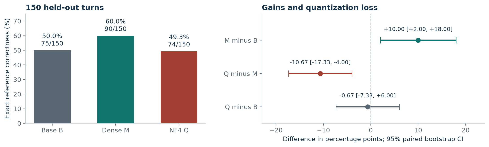

# Hermes tool calling on a T4

**Soup AI Engineer take-home | Pernav Jain | DON'T SHIP**

The dense merge improves exact tool-call correctness from **50.0% to 60.0%**. NF4 reduces it to **49.3%**, while a general tool-call regression and an unresolved merge-equivalence check also block release. This repository contains the completed experiment, including the failed gates.

[Two-page report](report.pdf) · [Email attachment](https://github.com/here-2007/soup-hermes-t4-takehome/releases/latest/download/pernav-jain-soup-email-submission.zip) · [Full archive](https://github.com/here-2007/soup-hermes-t4-takehome/releases/latest/download/soup-ai-engineer-submission.zip) · [Exact model artifacts, Kaggle v1](https://www.kaggle.com/models/pernavjain/soup-experiment/PyTorch/experiment-artifacts/1)

## What to attach to the email

Attach **`pernav-jain-soup-email-submission.zip` (5.95 MiB)**. This is a curated submission with the report, both executed notebooks, original verifier, exact training data/configuration, all raw command/device logs, saved predictions and check results. It has its own short README and a working CPU review command.

The attachment leaves seven large binary probe tensors, older automated report drafts and most preparation cache files in the full archive. `EMAIL_MANIFEST.json` names every omission. No failed log, result or test prediction is removed or shortened. Model weights remain on Kaggle. The separate full archive contains the complete repository and original preparation records.



## Review in five minutes

1. Read [report.pdf](report.pdf) for the decision, memory analysis, training proof and release conditions.
2. Open [the original verdict](run/verdict.json), [merge/export checks](run/evidence/fidelity-and-export-controls.json) and [selected-seed training evidence](run/evidence/training-42.json).
3. Run the CPU review below to verify the manifests, rescore all 450 saved B/M/Q test predictions and reproduce all three bootstrap comparisons.
4. Use [the evidence map](docs/evidence-map.md) to find the raw logs and inspect individual claims.

```bash
python3 -m venv .venv
source .venv/bin/activate
python -m pip install -r requirements-review.txt
python tools/review.py
python -m unittest discover -s tests -v
```

Python 3.11-3.13 is supported. The CPU review exits **0 when the saved evidence is internally consistent**, including the recorded DON'T SHIP decision. It exits 1 on a failed integrity or replay check. It does not run model inference, certify reference semantics or independently repeat GPU measurements. See [the captured review output](analysis/review.json).

## Results

| Artifact | Exact turns | Assistant NLL | General tool-call suite |
|---|---:|---:|---:|
| Base B | 75/150, 50.00% | 0.64338 | 70.0% |
| Dense merge M | 90/150, 60.00% | 0.04658 | 57.5% |
| Saved NF4 Q | 74/150, 49.33% | 0.05657 | 55.0% |

M-B is **+10.00 percentage points**, 95% paired-group bootstrap CI [2.00, 18.00]. Q-M is **-10.67 pp**, CI [-17.33, -4.00]. NF4 loses 22 M-correct turns and gains six. All 150 test turns remain in the denominator; this is strict reference correctness, not an adjudicated user-success rate.

Three independent two-epoch runs complete 400 optimizer steps each. Each has 399 nonzero-LR steps, one zero-LR warmup step and no AMP skips. Validation selects seed 42; only that seed receives the final test. The 392 trainable tensors contain **9,232,384 scalar weights**. Training uses FP16 LoRA; quantization is a separate post-merge NF4 export.

Maximum primary training allocation is **4.855 GiB**; sampled device use is **5.569 GiB** on a 14.562 GiB usable T4. Dense export peaks at **6.436 GiB host RSS**. These measurements include allocator phase boundaries and raw device samples, with their sampling limits documented in the report.

## Submission contents

| Deliverable | Location |
|---|---|
| Final report, at most two pages | [report.pdf](report.pdf), [REPORT.md](REPORT.md) |
| Completed training/export/evaluation notebook | [02_train_and_verify_soup_t4.executed.ipynb](notebooks/02_train_and_verify_soup_t4.executed.ipynb) |
| Dataset-preparation notebook | [01_prepare_hermes_for_soup.executed.ipynb](notebooks/01_prepare_hermes_for_soup.executed.ipynb) |
| Original model-owning verification script | [run/verify_artifacts.py](run/verify_artifacts.py) |
| CPU integrity, scoring and decision replay | [tools/review.py](tools/review.py) |
| Timestamped commands, training and evaluation logs | [run/evidence/logs](run/evidence/logs), [commands.jsonl](run/evidence/commands.jsonl), [events.jsonl](run/evidence/events.jsonl) |
| Raw nvidia-smi output and host samples | [nvidia-smi.raw.log](run/evidence/nvidia-smi.raw.log), [host-samples.jsonl](run/evidence/host-samples.jsonl) |
| Exact data, Soup configurations and frozen policy | [run/data](run/data), [run/configs](run/configs), [run_policy.json](run/run_policy.json) |
| Data provenance, masks, exclusions and split manifest | [data-preparation](data-preparation) |
| Detailed analysis and remediation | [docs/analysis.md](docs/analysis.md) |
| Personal reflection and AI use | [docs/reflection-and-ai-use.md](docs/reflection-and-ai-use.md) |

`run/` preserves all 215 indexed original files plus their index. Its original automated `REPORT.md` and reflection placeholder are retained as historical records; the completed report and reflection linked above are the submission documents. Failed outcomes and raw logs are unchanged. The 53-entry data-preparation manifest is also preserved. Model weights are hosted separately to keep the repository and ZIP manageable.

## Reproduce on a T4

Open the completed notebooks in their numbered order. The first creates the four training inputs from the pinned Hermes source; the second consumes Kaggle dataset `pernavjain/tool-calling`, isolates one T4 and runs the original Soup pipeline. Its last auxiliary code cell uploads a backup to the author's Kaggle account; skip that cell when reproducing the experiment. Training and evaluation cells retain their original outputs.

Pinned identities, package versions, download instructions and the distinction between a new run and a replay are in [docs/reproduction.md](docs/reproduction.md). GPU reproduction creates new evidence; this submission reports the preserved run `20261110T044014005029Z`.

## Release conditions

Investigate the A/M numerical discrepancy with matched precision/kernels and broader validation probes; evaluate export alternatives on validation; address the general tool-call regression and source imbalance. Keep the original failed thresholds and use fresh held-out data for the revised candidate. The report does not claim that either a higher rank, more epochs or another quantization setting has already solved these failures.

The [reference submission](https://github.com/harshitthek/soup-dpo-takehome) informed the deliverable organization. Its model, results and conclusions are not evidence for this experiment. Dataset/model attribution is in [THIRD_PARTY.md](THIRD_PARTY.md).
